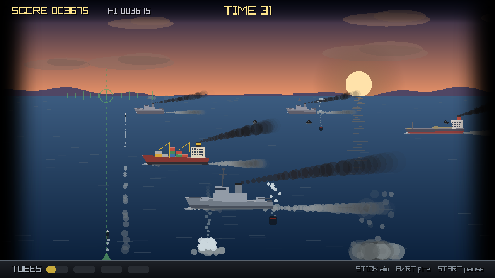
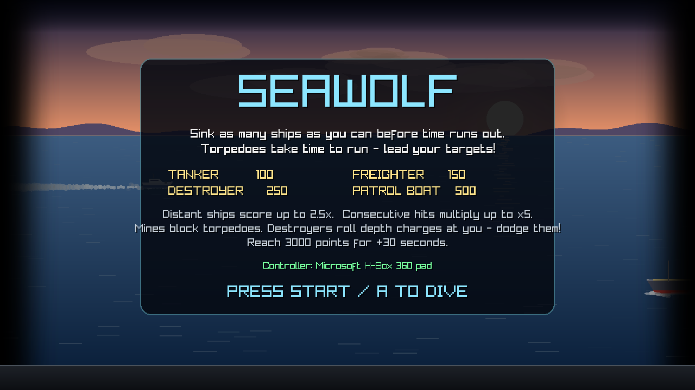
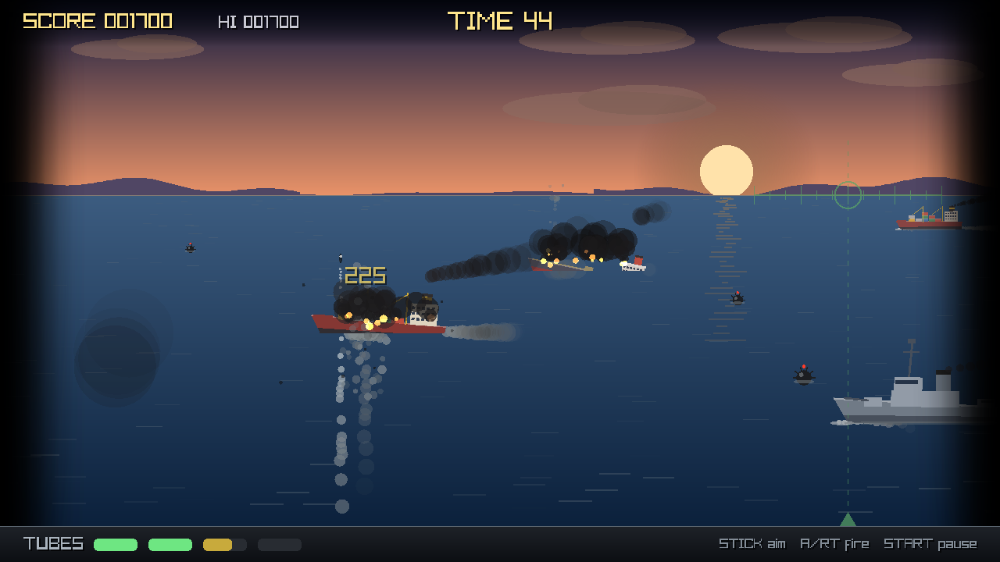

# Seawolf

A periscope torpedo game written in C++ with [raylib](https://www.raylib.com/).
Ships cross the sea at different distances. Aim the periscope, fire ahead of
your target, and sink as many ships as you can before time runs out.



## Features

- Four shipping lanes with perspective: tankers, freighters, destroyers and patrol boats
- Torpedoes take time to travel, so you have to aim ahead of a moving ship
- Ships farther away score up to 2.5×, and consecutive hits multiply your score up to ×5
- Drifting mines stop torpedoes. Destroyers roll depth charges at you. Steer clear, or your periscope floods.
- Fire, smoke and water spray, plus screen shake
- All sound effects are generated in code, so there are no asset files
- Works with a gamepad, including Xbox 360 clones that GLFW doesn't recognize
- The window can be resized, and F11 switches to borderless fullscreen

| Title | Direct hit |
|---|---|
|  |  |

## Building

You need CMake 3.16+, a C++17 compiler, and the X11/OpenGL development headers
(on Debian/Ubuntu: `libx11-dev libxrandr-dev libxinerama-dev libxcursor-dev libxi-dev libgl1-mesa-dev`).
CMake downloads and builds raylib 5.5 automatically.

```sh
cmake -S . -B build
cmake --build build -j
./build/seawolf
```

## Controls

| Action | Gamepad | Keyboard |
|---|---|---|
| Aim | Left stick / D-pad | ← → or A / D |
| Fire | A, RB or RT | Space |
| Start / pause | Start | Enter / P |
| Quit | Back (title / game over) | Esc |
| Fullscreen | | F11 |

## Rules

| Ship | Points |
|---|---|
| Tanker | 100 |
| Freighter | 150 |
| Destroyer | 250 |
| Patrol boat | 500 |

- A round lasts 90 seconds. Reaching 3000 points adds 30 seconds.
- You have 4 torpedo tubes, and they reload one at a time.
- A depth charge that reaches your periscope stops you firing for 2 seconds and costs 5 seconds.
- The high score is saved in `~/.seawolf_hi`.

Set `SEAWOLF_AUTOPLAY=1` to let a simple bot play (a demo mode).

## Terminal version

`go-terminal/` contains an earlier version that runs in the terminal, written in Go with
[tcell](https://github.com/gdamore/tcell). Run it with `cd go-terminal && go run .`

## License

[MIT](LICENSE) © 2026 Steve Thielemann
